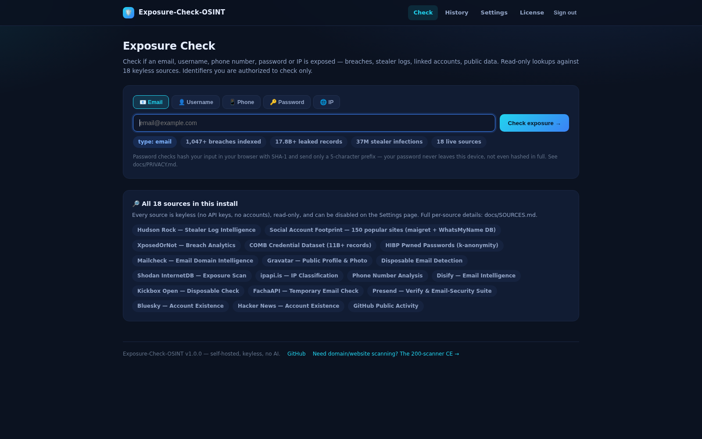
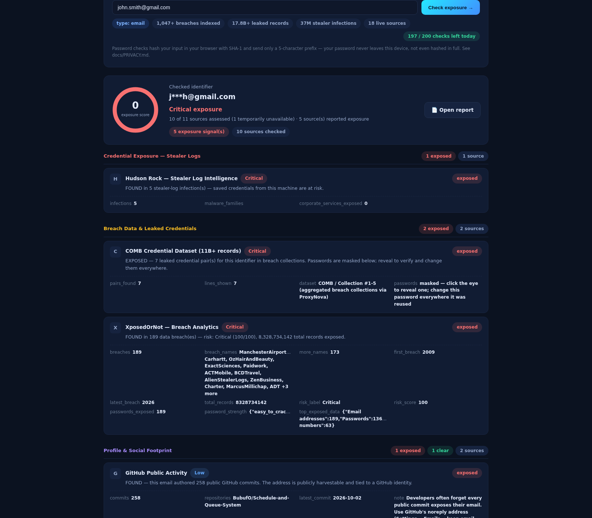
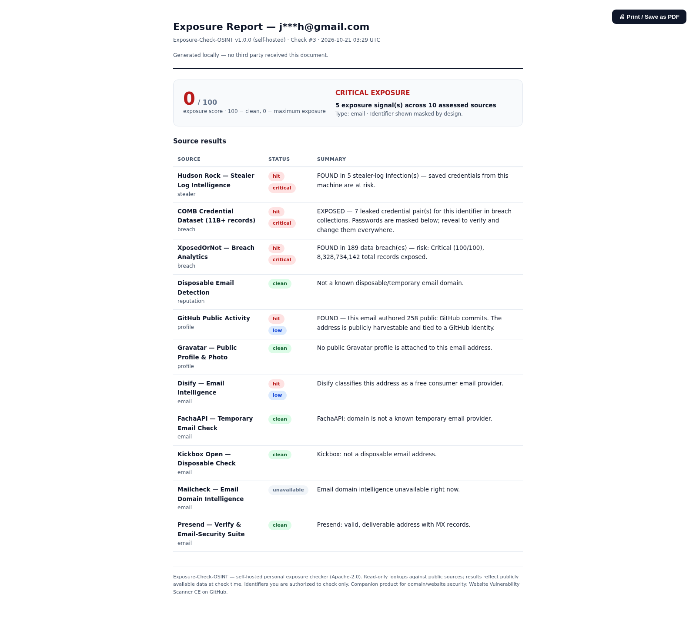

<div align="center">



# 🛡️ Exposure-Check-OSINT

### Is your email, username, phone number or password leaked? Find out — self-hosted, keyless, no AI.

[](https://github.com/RanaKhan77/Exposure-Check-OSINT/actions/workflows/ci.yml)
[](LICENSE)
[](composer.json)
[](#-why-no-ai-is-a-feature)
[](#%EF%B8%8F-the-23-sources)
[](#-quick-start)

Check your personal identifiers against **23 free OSINT sources** — breach databases,
infostealer corpora, 11B+ leaked credential pairs, 150+ platform username registries —
from your own server, with your own eyes.

**The companion OSINT tool to the [202-scanner Website Vulnerability Scanner CE](https://github.com/RanaKhan77/Website-Vulnerability-Scanner).**

[Quick Start](#-quick-start) · [The 6 Checks](#-the-6-checks) · [Sources](#%EF%B8%8F-the-23-sources) · [Why](#-why-this-exists) · [Privacy](#-privacy-by-design) · [FAQ](docs/FAQ.md) · [Donate](#-support-the-project)

</div>

---

## 📸 What you get — real screenshots, live product



**The dashboard.** Paste any identifier — the type is auto-detected, the corpus stats
(1,047+ breaches, 17.8B+ leaked records, 37M stealer infections) are computed from the
actual local indexes, not marketing numbers.



**Live results.** One scan fans out to every supporting source **in parallel** and renders
one honest card per source — with severity badges, per-source evidence, and an exposure
score that never fakes a pass (100 = clean, 0 = maximum exposure):

- 📧 **Email** → breaches, stealer-log infections, disposable flags, public-code associations
- 👤 **Username** → registered on which of 150 platforms (logo grid), Bluesky, Hacker News
- 📱 **Phone** → validity, country, line type, COMB leak association
- 🔑 **Password** → HIBP Pwned Passwords with **k-anonymity** (only a 5-char hash prefix leaves your browser — the password never does)
- 🌐 **IP** → open ports (Shodan InternetDB), VPN/proxy/hosting classification

Every card is one of **exposed / clear / unavailable** — a dead source degrades honestly,
it never counts as "clear". Results stream into a graphical report with platform logos,
persist to local history, and print to PDF from the browser.



**The report.** A self-contained printable document — generated locally, identifier masked
by design (`j***h@gmail.com`), every source verdict in one table, one click to PDF.

## 🚀 Quick Start

```bash
git clone https://github.com/RanaKhan77/Exposure-Check-OSINT.git
cd Exposure-Check-OSINT
./install.sh
```

That is the whole install: one Docker container (Apache + PHP + SQLite — no MySQL, no
Redis, no API keys), a generated admin password, and `http://localhost:8080` ready.
Details and non-Docker paths: [docs/SELF-HOSTING.md](docs/SELF-HOSTING.md).

Self-test the whole stack any time (23-source reachability, storage, database,
site database — seconds, no real check performed):

```bash
docker compose exec app php artisan ec:doctor     # add --json for machine-readable output
```

```
Sign in → paste an email → watch 23 sources answer in parallel → open the printable report.
Export any stored check as JSON or CSV — report page, history table, or right after a live check.
```

## 🔎 The 6 Checks

| Check | Input | What it answers |
|-------|-------|-----------------|
| 📧 Email exposure | any email | Which breaches / stealer logs / COMB corpora contain it · disposable? · Gravatar? · which of ~120 platforms hold an account |
| 👤 Username exposure | one username | Which of 150 platforms have it registered (logo grid, confidence tiers: confirmed vs probable) · Bluesky · Hacker News |
| 📱 Phone exposure | E.164 number | Valid, country, line type, carrier class · COMB leak association |
| 🔑 Password exposure | a password | How many times it appears in breach corpora — **hashed in your browser, 5-char prefix only** |
| 🗺️ Domain infrastructure | a domain | CT-log subdomain history (every hostname that ever got a TLS certificate) · RDAP registrar, dates and statuses — registration age as a fraud/trust signal |
| 🌐 IP exposure | IPv4/IPv6 | Open ports + services · VPN/proxy/hosting classification |

Full explanations with screenshots-level detail: [docs/CHECKS.md](docs/CHECKS.md).

## 🛰️ The 23 Sources

All **keyless** (no API key, no account, no cost), all read-only lookups (HTTPS or plain
DNS), all toggleable on the Settings page:

**Breach & stealer (5):** HudsonRock infostealer corpus · XposedOrNot breach analytics ·
ProxyNova COMB (11B+ pairs) · HIBP Pwned Passwords (k-anonymity) · LeakLens phone/username breach search

**Username & social (3):** Maigret + WhatsMyName corpus (150 sites, logo grid) ·
Bluesky (AT Protocol) · Hacker News

**Email intelligence (8):** Mailcheck · Gravatar · Disify · Kickbox Open · FachaTemp ·
Presend · disposable-domain blocklist · GitHub public search

**Phone & IP (5):** PhoneValidity (E.164) · Shodan InternetDB · ipapi.is · Bot-CIDR crawler
attribution · DNS blocklist reputation (Spamhaus ZEN, SpamCop, Barracuda — pure DNS, honest
degradation when a zone refuses your resolver)

**Domain & registry (2):** crt.sh — certificate-transparency subdomain history · RDAP domain registration records

Per-source endpoints, attribution and license notes: **[docs/SOURCES.md](docs/SOURCES.md)**.

Prefer reading offline? Every documentation section also ships as a print-ready PDF in
**[pdfs/](pdfs/)** — overview guide, the 6 checks, the 23 sources, self-hosting,
privacy and FAQ.

## 🧠 Why "no AI" is a feature

Every verdict is a deterministic, reproducible HTTP lookup. No model, no API bill, no
hallucinated findings — and a source that cannot answer says `unavailable` instead of
guessing. The same discipline as the scanner CE: **honest results, evidence first.**

## 🔒 Privacy by design

- **Identifiers are never stored raw** — salted hashes + masked forms (`j***n@gmail.com`) only
- **Password checks store nothing** — the match happens in your browser
- **No analytics, no third-party JS, no tracking** — the dashboard is self-contained
- **Your data, your disk** — SQLite on your machine; delete any record or purge everything in one click
- **Zero unsolicited network calls** — the only optional outbound call beyond the lookups happens
  when you explicitly activate/refresh a key, and the license heartbeat is opt-in (`LICENSE_HEARTBEAT=on`)

Full honest breakdown of every byte that leaves the server: **[docs/PRIVACY.md](docs/PRIVACY.md)**.

## 📜 Licensing — Free Forever, No Wall

This project is open source (Apache-2.0). **There is no license wall** (v2, Oct 2026 — same
policy as the scanner CE):

1. **Everything works forever without a key.** All 22 sources, all 6 checks, reports,
   history and exports — no trial countdown, no feature held back, no "activate to
   continue" screens. (v1 had a 14-day trial after which new checks paused; that wall
   was removed — it contradicted the "free forever" promise.)
2. **An optional free key** — issued instantly at
   [2mny.com/community-license](https://2mny.com/community-license), no account required —
   powers exactly two things: the project's aggregate install counter (which drives the
   roadmap) and free premium update announcements. That's all it does.
3. **Zero telemetry by default.** No heartbeat, no scheduled phone-home, no analytics. The
   only network calls the license client ever makes happen when *you* explicitly activate,
   refresh or deactivate a key on the license page (payload: key, random install ID,
   domain, version — nothing else). Operators who *want* to appear on the public install
   map can opt in with `LICENSE_HEARTBEAT=on`; it is off unless you turn it on.
4. **Fully offline-friendly.** An install with no key, a dead key, or no internet access
   checks exactly the same as an activated one.
5. **It's open source.** The client is ~300 auditable lines and trivially removable — we
   prefer honest optional telemetry over fake DRM. Code: `app/Services/CommunityLicenseService.php`.

## 🧭 Why this exists

The email-OSINT space is full of dead tools with huge audiences — holehe (15.3k ⭐,
unmaintained since 2024), mosint (6.1k ⭐, same story) — and the self-hosted
"check everything about me" niche is nearly empty. Exposure-Check-OSINT ships into that
gap with the strongest 100% keyless source combination available, the honest-verdict
discipline of a commercial scanner company, and zero AI cost forever.

| If you need… | Use |
|---|---|
| Personal identifier exposure (email/username/phone/password/IP) | **This repo** |
| Domain & website vulnerability scanning (202 modules) | [Website-Vulnerability-Scanner](https://github.com/RanaKhan77/Website-Vulnerability-Scanner) |
| A curated map of 519 free security tools | [awesome-cyber-security-heaven](https://github.com/RanaKhan77/awesome-cyber-security-heaven) |

## 🤝 Contributing

Bug reports, source corrections and new keyless sources are welcome — read
[CONTRIBUTING.md](CONTRIBUTING.md) first. New sources must be keyless, read-only, and
pass the contract tests (`vendor/bin/phpunit`).

## 💖 Support the project

**Exposure-Check-OSINT is free, forever, and Apache-2.0.** If it saved you a bad morning:

- ⭐ **Star this repo** — stars are how free software gets found; it genuinely helps.
- 🔁 **Share it** with the one friend who still reuses `Summer2019!` everywhere.
- ☕ **Fuel the maintainers** — every donation goes straight into keeping the sources
  verified, the corpus fresh, and the free-forever promise real:

| | |
|---|---|
| 💵 **USDT (TRC-20)** | `TVsfHEzwb9zRz9nMpGVkdL7ABTTvmUcPii` |
| 💳 **PayPal / card** | [2mny.com/support](https://2mny.com/support) |

> Donation addresses are also pinned in the [2mny.com](https://2mny.com) footer —
> beware lookalikes; this repo's only official links are 2mny.com and this GitHub org.

**More from the same team** (same discipline: honest verdicts, evidence first):

| Repo | What it does |
|------|--------------|
| [Website-Vulnerability-Scanner](https://github.com/RanaKhan77/Website-Vulnerability-Scanner) | The 202-module self-hosted domain/website vulnerability scanner (the natural next step after you check yourself) |
| [awesome-cyber-security-heaven](https://github.com/RanaKhan77/awesome-cyber-security-heaven) | The 519-tool curated map of the best free security tools, license-verified |
| [2mny.com](https://2mny.com) | The hosted commercial platform both CAs are extracted from |

## 📄 License

Apache-2.0 for this repository's code. The username corpus carries upstream attribution
(maigret — MIT; WhatsMyName — CC BY-SA 4.0). See [LICENSE](LICENSE) and
[docs/SOURCES.md](docs/SOURCES.md).

---

<div align="center">



</div>
